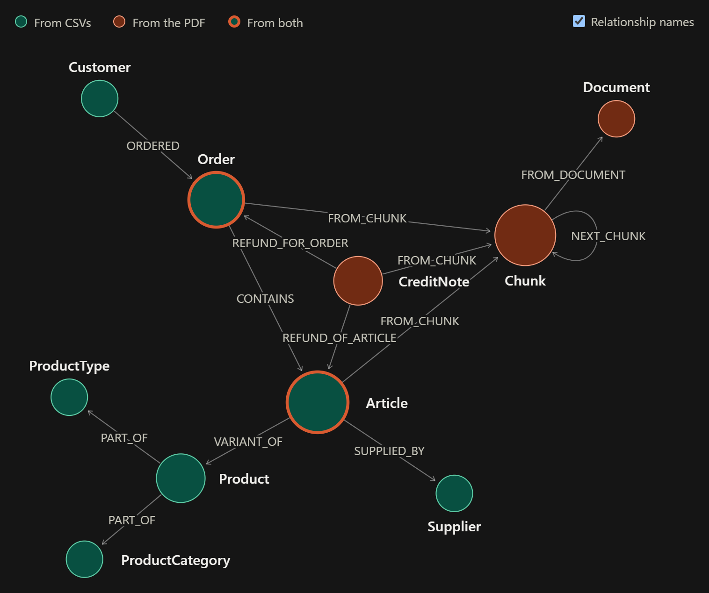
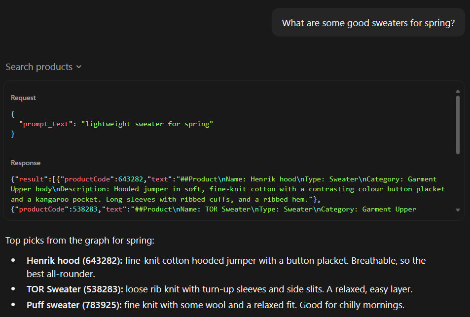
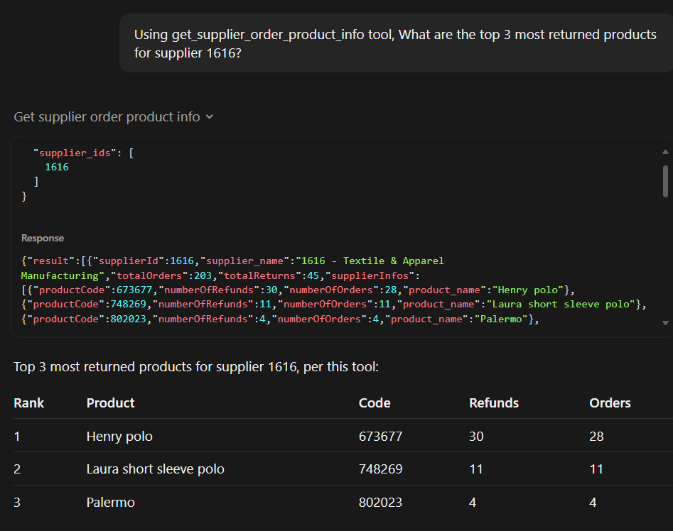
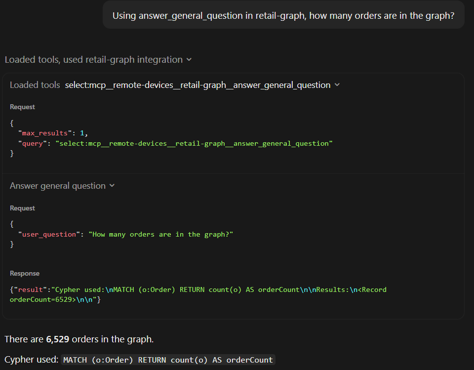
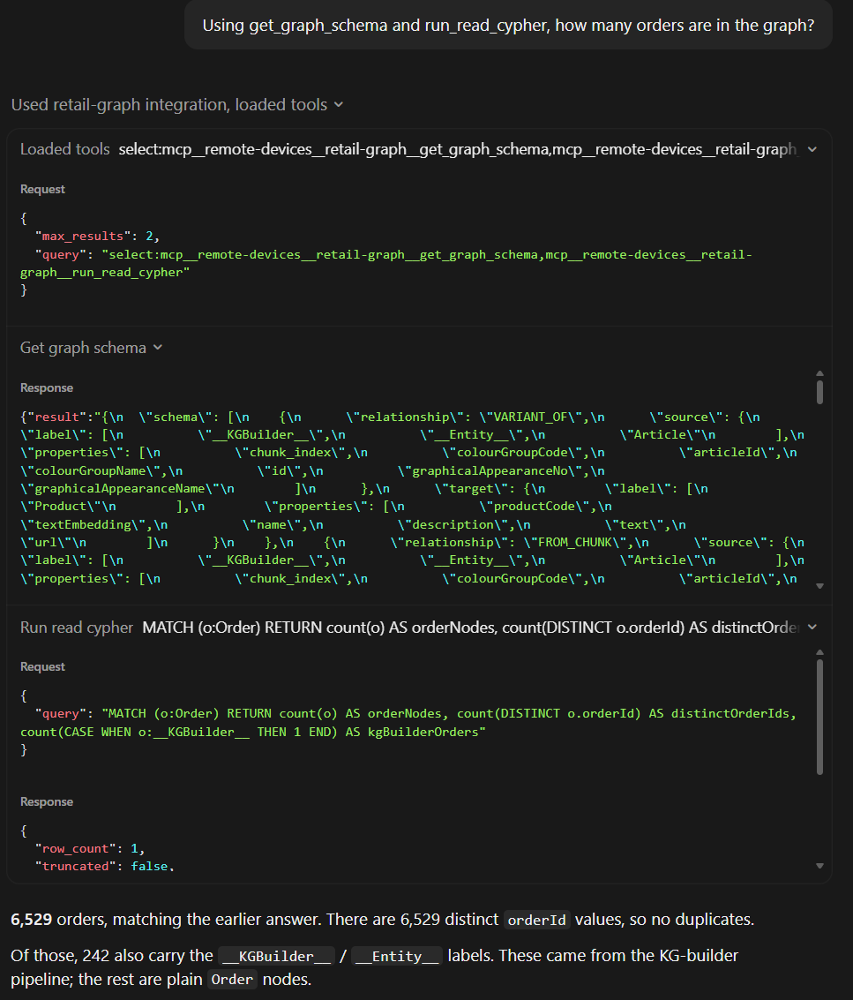
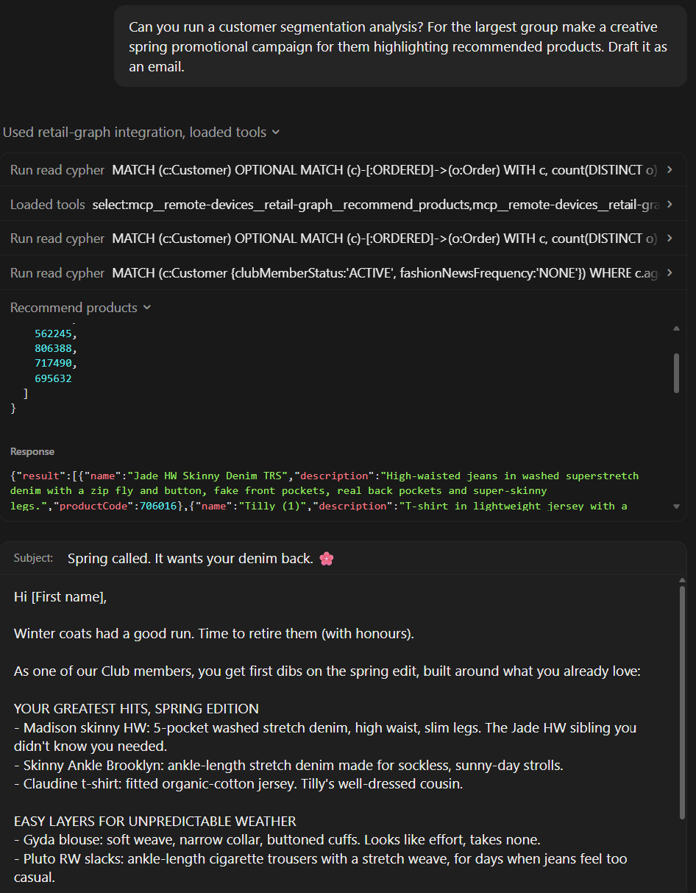
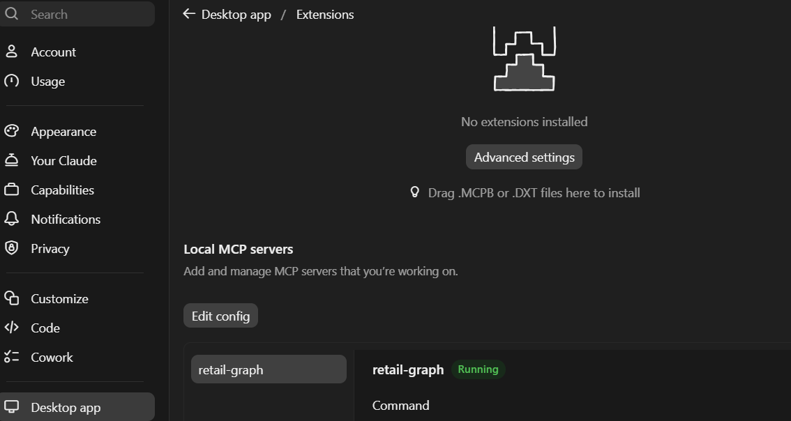

# GraphRAG fashion retail: Neo4j + Claude + MCP

A learn-by-doing GraphRAG project on a fashion-retail dataset. A Neo4j Aura graph is built from structured CSVs plus credit-note text extracted from a PDF, then exposed to Claude Desktop through a local MCP server (`customer-graph/graphrag/mcp_server.py`). Embeddings are computed locally (`all-MiniLM-L6-v2`, 384 dimensions). Source repo: [neo4j-product-examples/graphrag-examples](https://github.com/neo4j-product-examples/graphrag-examples) (`customer-graph`).

## How the data gets into Neo4j

Required credentials: 
create `customer-graph/.env` with `NEO4J_URI`, `NEO4J_USERNAME`, `NEO4J_PASSWORD` and `ANTHROPIC_API_KEY`.

### 1. Unstructured data: credit notes (PDF)

- **Source:** `data/credit-notes.pdf` (one PDF, 308 pages) - each credit note ID details the order ID and Article ID that being refunded
- **Chunking:** the PDF text is read page by page and split into chunks of up to 15,000 characters (using `LangChainTextSplitterAdapter` library), cutting at page breaks. Each chunk is embedded locally - allocated to the Chunk nodes’ `embedding` property. The project doesn't need this property. It's there by design of `SimpleKGPipeline` library.
- **Extraction:** Claude (through the Anthropic API) reads each chunk and extracts the entities and relationships defined in `ontos/customer.ttl`. `SimpleKGPipeline` writes them as `CreditNote`, `Order` and `Article` nodes, linked by `REFUND_OF_ARTICLE` and `REFUND_FOR_ORDER`, each tied back to its source `Chunk`. A chunk that fails is skipped (`on_error="IGNORE"`), so check the counts afterwards.
- **Clean-up:** duplicate `Article` and `Order` nodes are merged by `articleId` / `orderId`, and any `Product` nodes the LLM created are deleted, because products come from the CSVs.

### 2. Structured data: CSVs

| File | Becomes |
|---|---|
| `suppliers.csv` | `Supplier` |
| `products.csv` | `Product`, linked by `PART_OF` to `ProductType` and `ProductCategory` |
| `articles.csv` | `Article`, linked by `VARIANT_OF` to its `Product` and `SUPPLIED_BY` to its `Supplier` |
| `customers.csv` | `Customer` |
| `order-details.csv` | `Order` (`Customer -ORDERED-> Order`) and `Order -CONTAINS-> Article` (with `price`) |

Everything is loaded with `MERGE` on 7 uniqueness constraints (`articleId`, `orderId`, `customerId`, `supplierId`, `productCode`, and `name` for type and category). Reruns are safe, and the `Article` / `Order` nodes created from the PDF are enriched with the CSV data instead of duplicated.

### 3. Post-processing

Builds a text description for each product (name, type, category, description) in `Product.text`, embeds it locally into `Product.textEmbedding`, and creates the cosine vector index `product_text_embeddings`. Products without a description are skipped.

**Counts after loading:** Article 13,351 · Order 6,529 · Product 8,044 (8,018 embedded) · Customer 1,000 · Supplier 266 · CreditNote 307.
 

### 4. A completed graph after all ingestions:


## MCP tools:

| Tool | What it does | Input |
|---|---|---|
| `search_products` | Finds the products whose description is closest in meaning to your text, e.g. "light summer dress". | free text |

| `get_supplier_order_product_info` | Returns each supplier's total orders and refunds, plus a per-product breakdown. Counts are per order line / credit-note line, so they can be higher than the number of distinct orders. | supplier IDs |

| `answer_general_question` (Option A) | Answers any other question about the graph. The MCP server asks Claude to write the Cypher, runs it, and returns the Cypher and the rows. | a question in plain English |

| `get_graph_schema` (Option B) | Returns the graph schema plus a few example questions with their Cypher, so the chat model can write its own queries. | none |
| `run_read_cypher` (Option B) | Runs a read-only Cypher query that the chat model wrote (up to 50 rows, 15-second timeout). | a Cypher query |

| `recommend_products` | "People who bought these also bought": returns up to 20 products that other buyers of the same items also ordered, ranked by how often. Segment IDs appear in the tool description, but this project doesn't create them. | product codes or article IDs |



# Agent notes: who generates the Cypher?

There are 2 ways to get a Cypher query:

## Option A: the MCP server calls Claude to generate the Cypher
- Tool: `answer_general_question`, which calls `text_to_cypher_query` 
- `Text2CypherRetriever` sends the graph schema (`ontos/text-to-cypher.json`), the `custom_prompt` template and the user's question to Claude through an API call (`self._llm`). The MCP server gets the Cypher statement back from Claude's API response, runs it on Aura, and returns the Cypher and the rows to the chat model, which reads them and writes the answer to the user. On failure it retries up to 3 times, so one question can trigger up to 3 API calls.
- Billing: schema reading and Cypher generation are billed separately to my **API account**. The chat model still uses chat usage to decide to call the tool, read the returned Cypher and rows, and write the answer.

## Option B: the chat model writes the Cypher
- Tools: `get_graph_schema` and `run_read_cypher`. The MCP server makes no LLM call, so there is no cost on my API account.
- The chat model calls `get_graph_schema`, which returns the schema text as a tool result (input tokens). The chat model then writes the Cypher itself (output tokens). Then it calls `run_read_cypher` with the Cypher it wrote, the MCP server runs it on Aura (read-only) and returns the rows to the chat model, which reads them and writes the answer to the user.
- Billing: everything goes into my Claude plan's usage limit.

In both options an LLM generates the Cypher, and the MCP server is the one that connects to Aura and runs it.

## Setup (uv)
 
[uv](https://docs.astral.sh/uv/) replaces `python -m venv` and `pip` here. The repo has no `pyproject.toml`, so it is not a uv project: dependencies live in `requirements.txt`.
 
```powershell
uv venv graphrag_venv --python 3.12
graphrag_venv\Scripts\Activate.ps1
uv pip install -r requirements.txt
uv pip install "mcp[cli]<2"
```

- **Run everything with the venv's `python`**.


## Connect the MCP server to Claude Desktop
 
 
1. Open **Settings → Desktop app → Extensions**. Under **Local MCP servers**, click **Edit config**. This opens `claude_desktop_config.json`. Use the button instead of hunting for the file: on my Windows Store install it lives under `%LOCALAPPDATA%\Claude-Data\claude_<id>\`, not the `%APPDATA%\Claude\` folder that older docs mention.

2. The file already contains Claude's own settings (`preferences`), so don't replace it. Add an `mcpServers` entry next to them, separated by a comma:
  ```json
    "mcpServers": {
      "retail-graph": {
        "command": "C:\\path\\to\\graphrag_venv\\Scripts\\python.exe"
        , "args": ["C:\\path\\to\\customer-graph\\graphrag\\mcp_server.py"]
      }
    }
  ```

4. **Fully quit and reopen Claude.** Closing the window isn't enough. Run `Stop-Process -Name claude -Force`.

5. Back in **Settings → Desktop app → Extensions → Local MCP servers**, `retail-graph` should show **Running**. 


